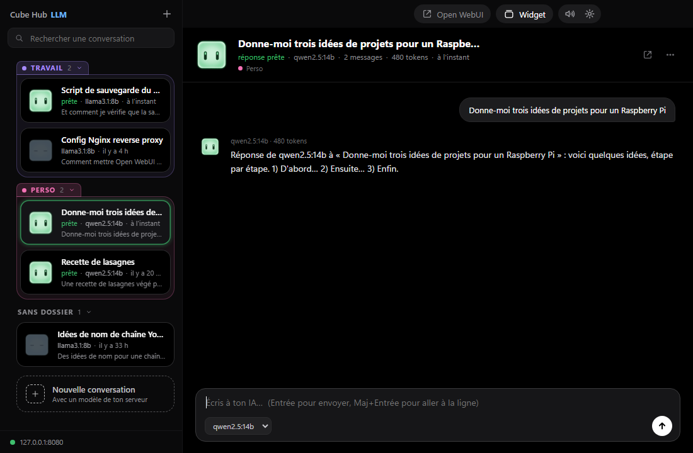

# Cube Hub LLM

Le cube de [Cube Hub](https://github.com/Harlo9/cube-hub) (app macOS de Harlo9, licence MIT), branché sur
les conversations de **ton IA locale** : Open WebUI + Ollama sur ton serveur. Pour **Windows**, **Ubuntu** et **Debian**.



| | |
|---|---|
| 🧊 **Le cube** | Bleu qui regarde à gauche et à droite : **ton IA écrit**. Vert, ses yeux suivent ta souris : **réponse prête**. Orange : **erreur**. Endormi : aucune conversation récente. |
| 🃏 **Le widget** | Toujours au-dessus : la conversation de devant en grand (dernière question, modèle, tokens), deux autres en dessous. **Ctrl+Alt+L** (Windows) ou **Ctrl+Alt+K** (Linux) le montre ou le cache. |
| 🗂️ **Le Hub** | Toutes tes conversations Open WebUI, rangées par **dossiers** (glisser une carte sur un dossier la range), recherche, et une vue de chat pour **lire et continuer** une conversation (réponse en direct, enregistrée dans Open WebUI). |
| 🔔 **Notifications** | Bulles de notification du système quand une réponse est prête ou a échoué. |
| 📱 **Telegram** | Les réponses sur ton téléphone quand tu n'es pas devant le PC. Tu peux aussi **continuer une conversation** en répondant au message, ou en commencer une avec `/nouveau`. Verrouillé par un code à 6 chiffres (app d'authentification). |

## Installer

Les paquets sont dans les **Releases** du dépôt.

**Ubuntu / Debian** (22.04, 24.04, Debian 12 et plus) :

```bash
sudo apt install ./cube-hub-llm_1.0.0_amd64.deb     # arm64 pour Raspberry Pi et ARM
cube-hub-llm                                          # ou depuis le menu des applications
```

Sans installation : `tar xf cube-hub-llm-1.0.0-linux-x64.tar.gz` puis `./cube-hub-llm-1.0.0-linux-x64/cube-hub-llm`.

- Sur **Debian avec GNOME**, le petit cube de la barre du haut demande l'extension AppIndicator :
  `sudo apt install gnome-shell-extension-appindicator` puis se reconnecter. (Ubuntu l'a déjà.)
- Sous **Wayland**, le raccourci clavier global peut ne marcher que quand une app X11 a le focus ;
  le menu du petit cube et le Hub restent là.
- La clé API est rangée dans le trousseau du système (GNOME Keyring ou KWallet).

**Windows** : dézipper `Cube-Hub-LLM-windows-x64.zip` et lancer `Cube Hub LLM.exe`.

## Brancher ton serveur

1. Dans Open WebUI : ton profil → **Réglages → Compte → Clés API → Créer une clé** (elle commence par `sk-`).
   Si la section n'apparaît pas, un administrateur doit activer les clés API (Panneau d'administration → Réglages → Général).
2. Lance **Cube Hub LLM** et donne l'adresse d'Open WebUI (celle de ton navigateur, par exemple `http://192.168.1.50:3000`, ou `http://localhost:3000` sur le serveur lui-même) et la clé.
3. Ton PC doit pouvoir joindre le serveur (même réseau, ou Tailscale). Sur Ubuntu, si besoin : `sudo ufw allow 3000`.

La clé et le token Telegram sont chiffrés sur ton ordinateur (DPAPI sous Windows, trousseau sous Linux). L'app ne parle qu'à ton serveur (et à Telegram si tu l'actives).

## Bon à savoir

- Le cube voit une réponse « en train de s'écrire » dans Open WebUI grâce aux tâches d'Open WebUI ; sur les vieilles versions,
  il ne la voit qu'à la fin. Les réponses écrites depuis Cube Hub LLM sont toujours suivies en direct.
- Les modèles chargés par Ollama (Réglages → Serveur) ne sont visibles qu'avec un compte administrateur d'Open WebUI.

## Construire

```powershell
npm install
npm run assets    # images du cube (depuis ../cube-hub) et icône
npm start
npm run package   # Windows : dist/Cube Hub LLM/Cube Hub LLM.exe
node scripts/package-linux.js amd64 arm64   # Linux : dist/linux/*.deb et *.tar.gz (marche aussi depuis Windows)
```

Vérifications sans serveur : `npm run mock` lance un faux Open WebUI (clé `sk-test`), puis
`CUBE_SCENARIO=<dossier> CUBE_LLM_URL=http://127.0.0.1:8080 CUBE_LLM_KEY=sk-test CUBE_LLM_DIR=<dossier temporaire> npx electron .`
joue un scénario complet et enregistre des captures (ajoute `CUBE_TELEGRAM_API` pour tester Telegram avec un faux serveur).

À chaque envoi sur GitHub, GitHub Actions fabrique les paquets, les **installe sur Ubuntu 24.04 et Debian 12**
et joue le scénario complet (captures dans les artefacts). Un tag `v1.2.3` publie une Release.
